# Paltop

**A dashboard for the admin and a web page for the players of a
[Palworld](https://www.pocketpair.jp/palworld) dedicated server in Docker.**

## To be clear, this has been coded/made using AI.

Paltop comes in two parts. Install one of them, or both:

- **Paltop terminal** is for the person who runs the server. It is a
  [btop](https://github.com/aristocratos/btop)-style dashboard in the
  terminal: is the server healthy, who is on, are the backups fine, why did it
  crash last night. An admin menu covers kicking, banning, backups and
  restores.
- **Paltop web** is for everyone who plays. It is a web page they open on a
  phone or a PC: who is online, all their Pals, a team builder, a boss
  planner, a Palpedia, Pal battles, achievements, quests and a chat with the
  players in the game.

Both read the server's REST API, Docker and the save files, and the
background collector records the server's history for both. Everything is
plain Python 3 with no packages to install.

Paltop terminal:
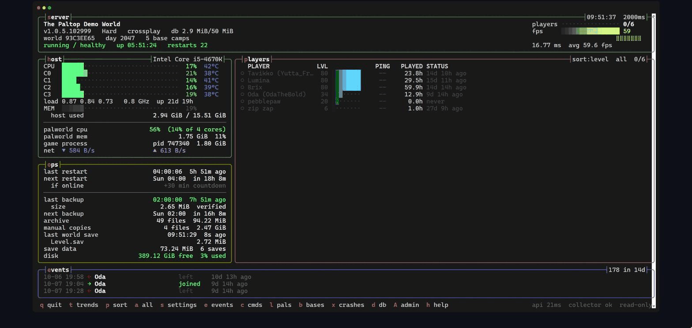

Paltop web:
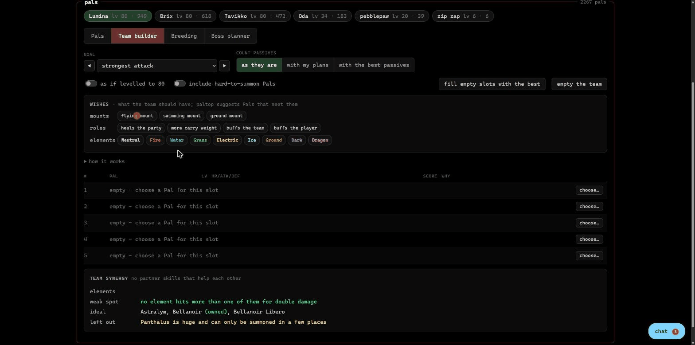

*The names in all screenshots are made up.*

## Which part do I need?

| | Paltop terminal | Paltop web |
|---|---|---|
| **For** | the server admin, over SSH | the players, in a browser |
| **Changes the server** | only from the admin menu, and it asks first | never (except the chat: a player's message is shown in the game) |
| **Runs as** | the `paltop` command, plus a background collector | a small HTTPS server (`paltop-web`) on port 8765 |

What each part shows:

| Feature | Terminal | Web |
|---|:-:|:-:|
| Server status, players online, AFK detection | ✓ | ✓ |
| Base camps and worker problems (sick, starving, unhappy) | ✓ | ✓ |
| Crash log with an automatic investigation | ✓ | ✓ |
| Every player's Pals: stats, IVs, passives, role scores | ✓ | ✓ |
| Team builder, passive planner, breeding helper | ✓ | ✓ |
| Host health: CPU and temperatures, memory, network, disk | ✓ | |
| Backups, restarts, world saves, save growth over time | ✓ | |
| Activity heatmap and 24 h history graphs | ✓ | |
| Join and leave log, world settings, database | ✓ | |
| Admin menu: save, backup, announce, kick, ban, restart, restore | ✓ | |
| Logins, one per player, linked to their character | | ✓ |
| Compare two Pals side by side, wishes for the team (mounts, elements, healer) | | ✓ |
| Boss planner: who beats which tower and raid boss, normal and hard mode | | ✓ |
| Palpedia and Paldeck race | | ✓ |
| Traitpedia: every passive trait, where to get it, what implanting it costs | | ✓ |
| Pal battles between players' Pals, automatic or fought by hand, with chiptune music | | ✓ |
| Achievements and server firsts | | ✓ |
| Quest list: what each player has done | | ✓ |
| Chat between the web page and the game | | ✓ |

## Paltop terminal

A live dashboard of the server and the machine it runs on.

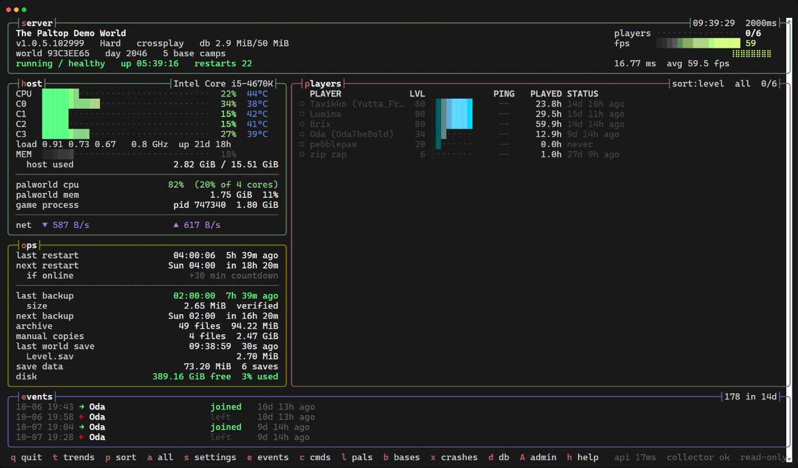

- **Crash log.** When the server hangs or crashes, paltop works out what
  happened: a hang, a crash, a host reboot or a scheduled restart. It also
  finds where the game code froze, who was online and what they had just
  done, and patterns across incidents.
- **Trends.** When your players are online, how the server's fps holds up,
  and how the world save grows.
- **Pals.** Every player's Pals with the same team builder as the web page.
- **Admin menu** (`A`). Save the world, make a backup, send an announcement,
  kick or ban, restart, or restore a backup. Anything that disconnects
  players asks for confirmation and says who is online first. Start with `--no-admin` for a
  strictly read-only dashboard.

| Crash log | Trends |
|---|---|
| 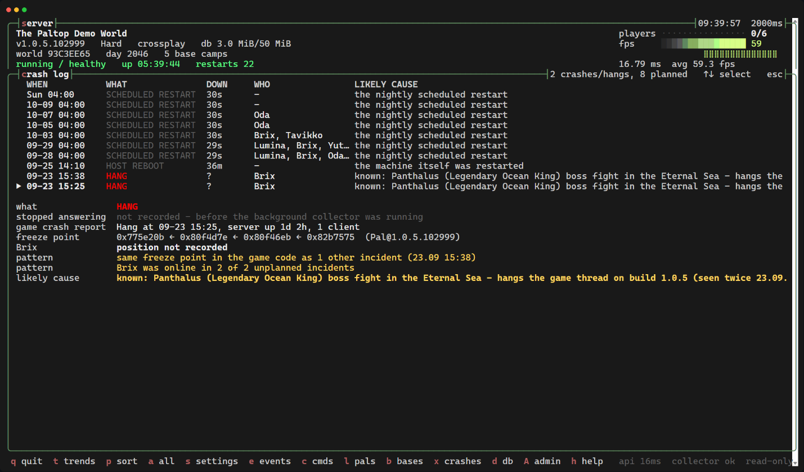 | 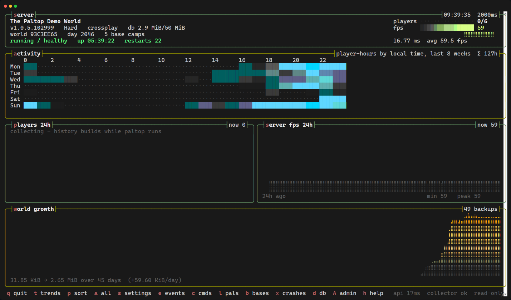 |
| **Pals** | **Team builder** |
| 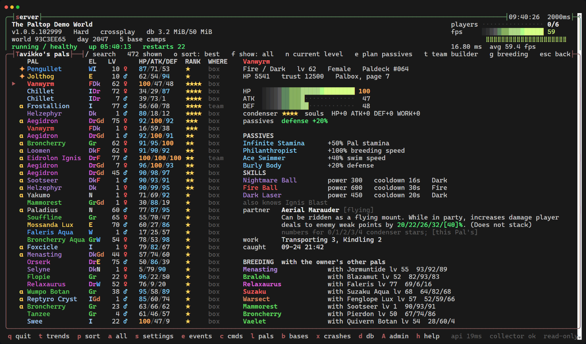 | 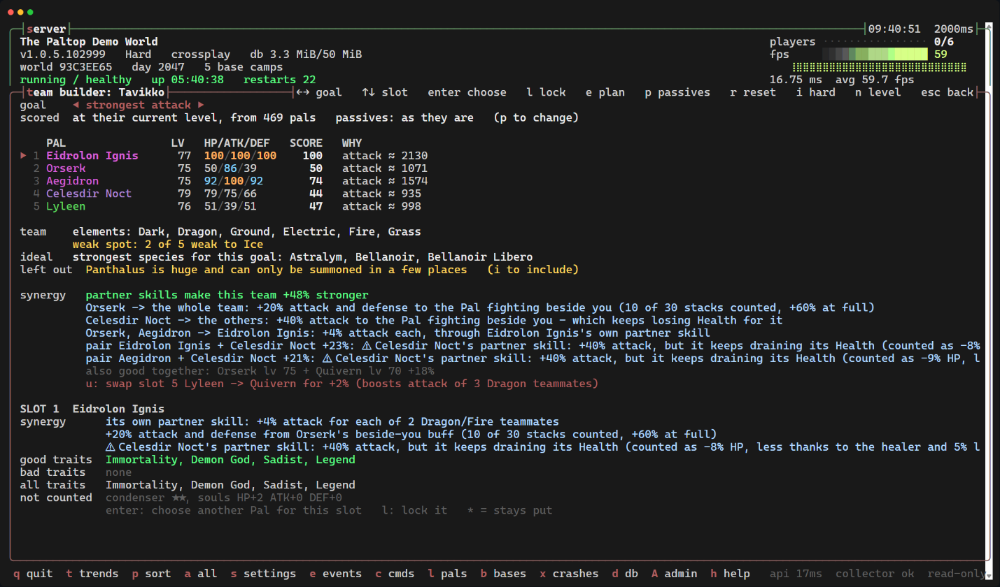 |

More in [docs/terminal.md](docs/terminal.md).

## Paltop web

A page for the players, served over HTTPS from the same machine. Each player
makes a user with their in-game name and the server's join password, and
the user is linked to their character.

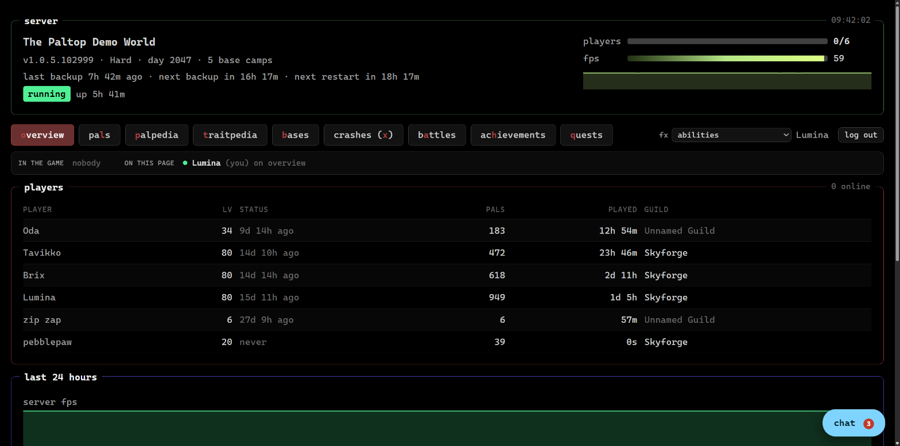

- **Pals and team builder.** All of a player's Pals with real stats. The team
  builder picks the best team for a goal (attack, defense, work and so on),
  counts partner-skill synergy, and suggests who to add next.
- **Boss planner.** For each tower and raid boss, normal or hard mode: which
  of your Pals deal the most damage, a suggested team, and who on the server
  has already beaten it.
- **Palpedia and traitpedia.** Every Pal and every passive trait, read from
  the game's own data on your server.
- **Battles.** Players' Pals fight with their real stats, skills and
  partner skills. Watch automatic battles, or fight a duel yourself against
  an opponent with hidden Pals.
- **Achievements, quests and chat.** Who has done what, and a chat that goes
  both ways between the page and the game.

| Pals | Compare two Pals |
|---|---|
| 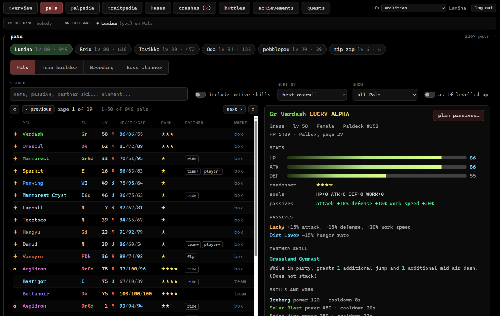 | 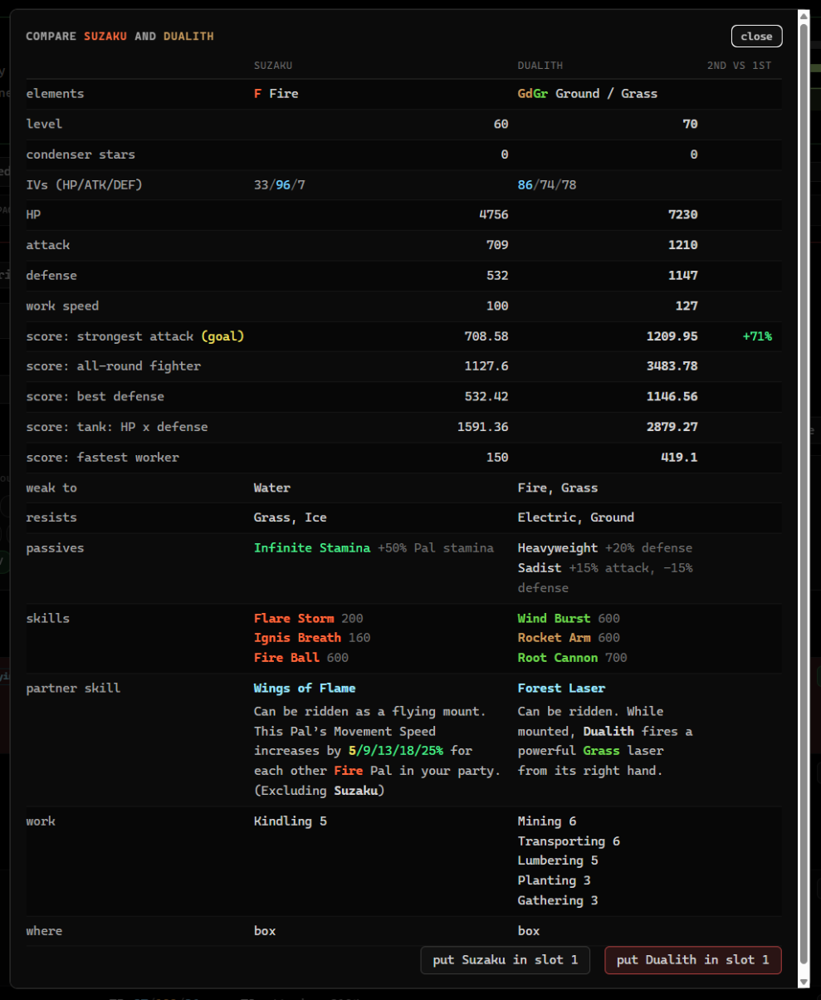 |
| **Team builder** | **Boss planner** |
| 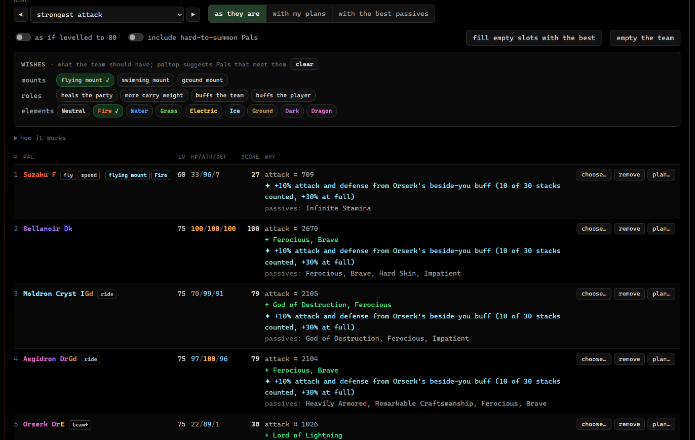 | 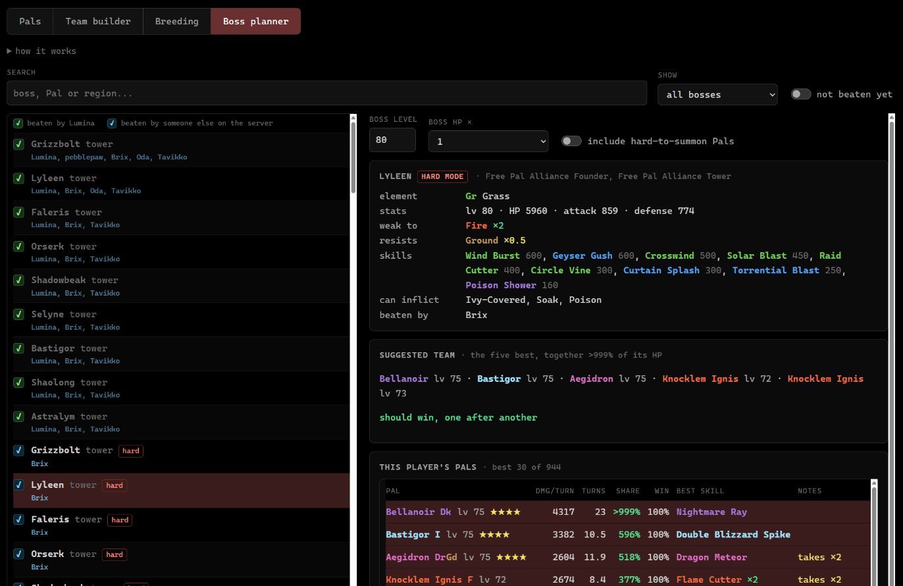 |
| **Palpedia** | **Traitpedia** |
| 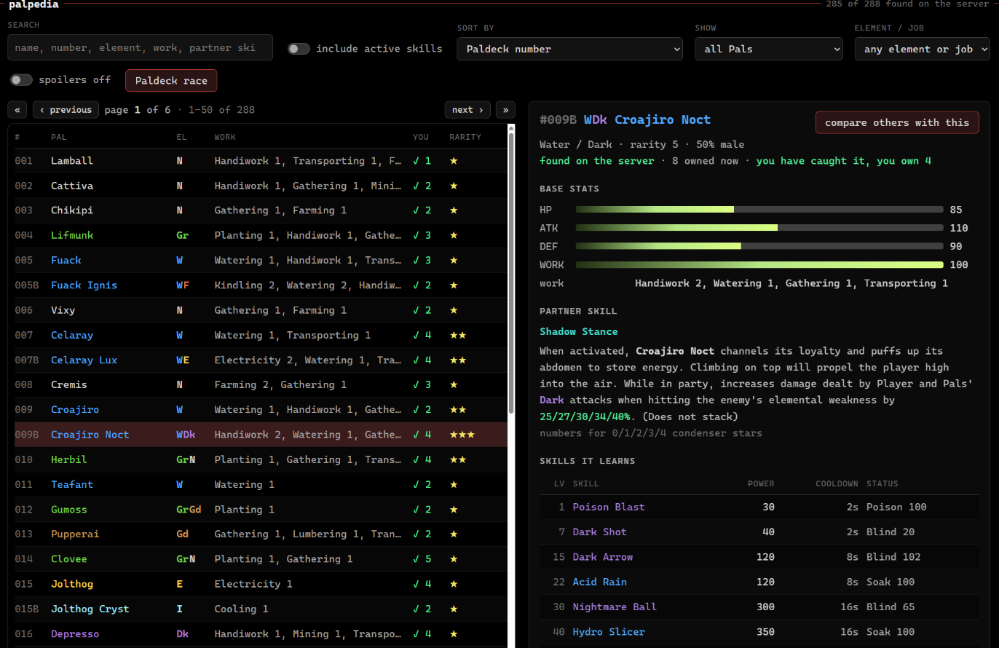 | 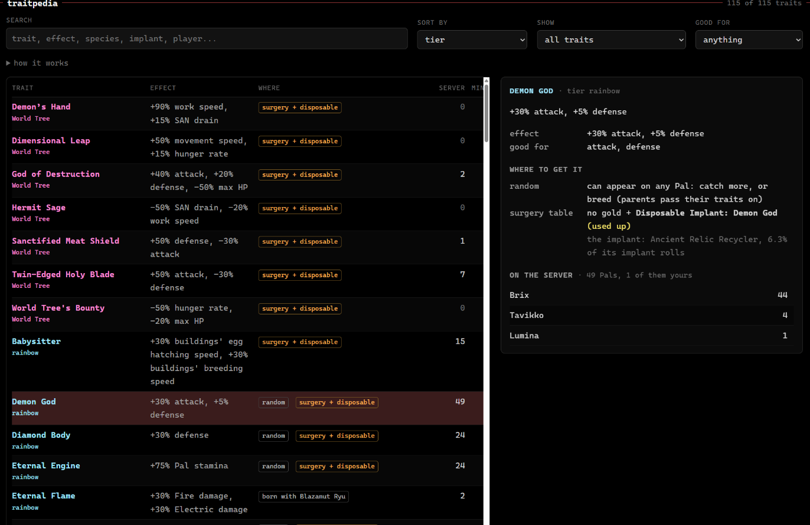 |
| **Achievements** | **Quests** |
| 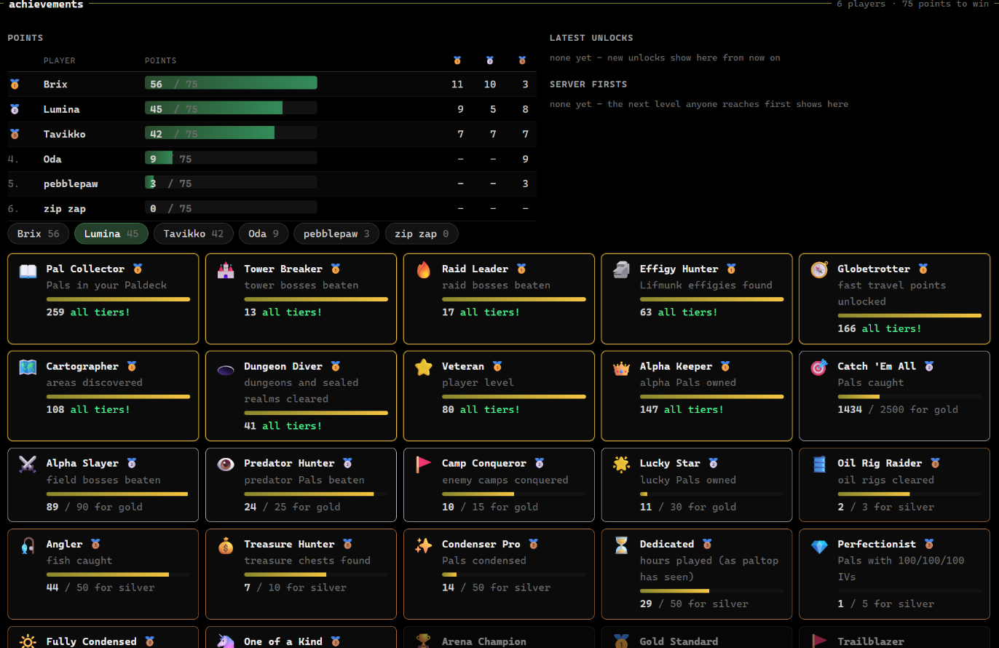 | 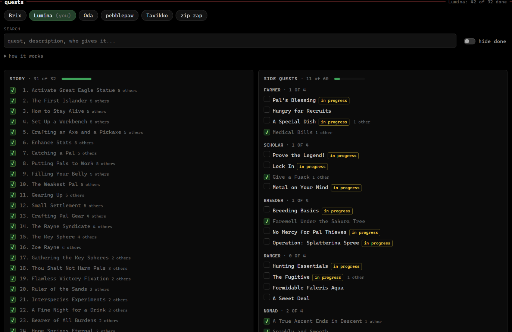 |
| **Fight a duel yourself** | **Chat with the game** |
| 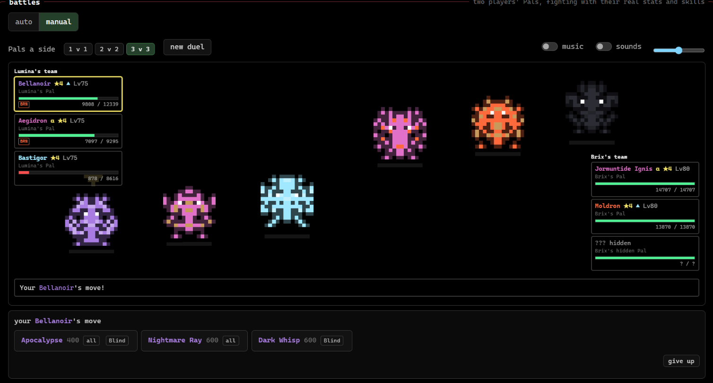 | 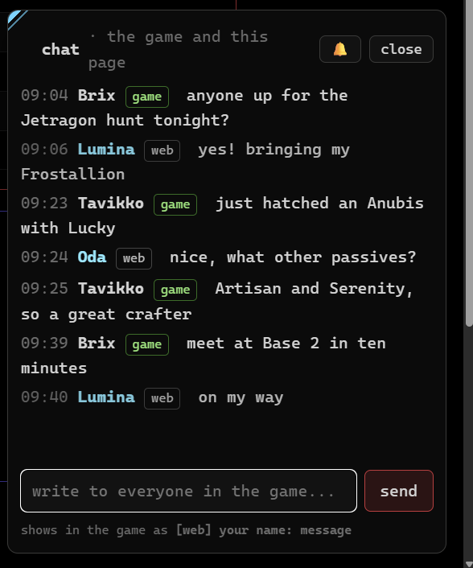 |

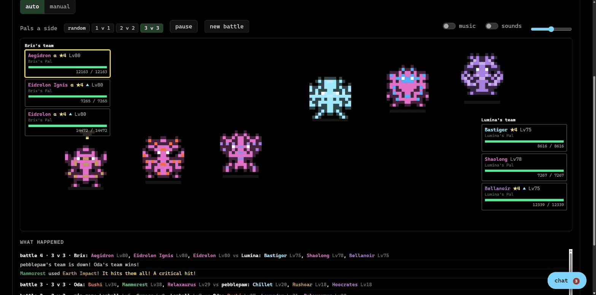

More in [docs/web.md](docs/web.md).

## Requirements

- Linux on x86_64, on the machine that runs the server
- a Palworld server in Docker, for example
  [thijsvanloef/palworld-server-docker](https://github.com/thijsvanloef/palworld-server-docker),
  with its REST API turned on (`REST_API_ENABLED=true`)
- Python 3.9 or newer, and a user that is allowed to run `docker`
- `g++` and `git` (or `curl`), to build the save-file decompressor
- `openssl`, for the web page (it makes its own HTTPS certificate)

## Install

Get both parts with git:

```bash
git clone https://github.com/SeanDavidS/paltop.git
```

Or download only the part you want from
[Releases](https://github.com/SeanDavidS/paltop/releases):

| Archive | Contains |
|---|---|
| `paltop-terminal-VERSION.tar.gz` | Paltop terminal |
| `paltop-web-VERSION.tar.gz` | Paltop web |
| `paltop-VERSION.tar.gz` | both |

Each archive has the shared core, the installer and the docs. Then, in the
directory:

```bash
./install.sh --terminal
```

```bash
./install.sh --web
```

```bash
./install.sh --all
```

`install.sh` runs Paltop from where it is, so keep the directory. It:

- builds `core/oodle/libooz.so`, the decompressor for the save files. It
  downloads [ooz](https://github.com/zao/ooz), see
  [core/oodle/build.sh](core/oodle/build.sh).
- puts `paltop` in `~/.local/bin` (terminal)
- sets up the systemd user services `paltop-collector`, and `paltop-web` on
  port 8765 for the web page

It does not touch the Palworld server or its container, and needs no root.

Options:

- `--container NAME` if the server's container is not called `palworld-server`
- `--port N` for the web page
- `--no-collector` for a terminal without the background collector (history
  is then only recorded while paltop is open)
- `--uninstall` removes the services and the command, and keeps your data

To keep the services running while you are logged out:

```bash
sudo loginctl enable-linger $USER
```

Then run `paltop` in a terminal, or open `https://<server address>:8765` in a
browser. The first time, the browser warns about the certificate, because the
page makes its own.

## Safety

- **Paltop web changes nothing.** It has no admin actions. The only thing
  it sends to the server is a chat message a logged-in player writes, shown
  in the game as an announcement and rate-limited.
- **Paltop terminal** only reads, unless you use the admin menu.
- The game's files are opened read-only, and nothing is ever written back to
  a save.
- Your data (history, the web page's users and certificate) stays in
  `state/`, which is never part of the repository.

More in [docs/core.md](docs/core.md).

## Settings

Everything is found from `docker inspect` of the container. These
environment variables change where things are (install.sh writes the first two
into the services):

| Variable | Default | |
|---|---|---|
| `PALTOP_CONTAINER` | `palworld-server` | the server's container |
| `PALTOP_STATE` | `state/` in this directory | history database, caches, the web page's certificate and users |
| `PALTOP_PAK` | found through the container's `/palworld` mount | the game's `Pal-LinuxServer.pak` |
| `PALTOP_OODLE` | `core/oodle/libooz.so` | the decompressor |
| `PALTOP_CORE` | `core/` beside `terminal/` and `web/` | where the shared modules are |

## Layout

```
core/       shared: palsource (the server), palsave (save files), palpak (the
            game's data), palstore (history database),
            palcollect (the background collector), palpals, palteam,
            palbattle, palboss, palpedia, paltraits, palquests, palchat,
            palachieve, palcrash, palpaths
core/oodle/ build.sh and paltop's wrapper for the save-file decompressor
terminal/   paltop.py (the dashboard), paladmin.py (the admin menu), paltop
web/        palweb.py (the server), static/ (the page, its script, the battle
            music)
docs/       terminal.md, web.md, core.md, images/
install.sh  the installer; tools/package.sh makes the release archives
state/      created at install: your data, never part of the repository
```

## Contributing

Bug reports, ideas and pull requests are welcome, see
[CONTRIBUTING.md](CONTRIBUTING.md). For security problems, see
[SECURITY.md](SECURITY.md).

## License

MIT, see [LICENSE](LICENSE). ooz, which the installer downloads and builds,
is not part of Paltop and is never shipped with it: its Kraken decompressor
(`kraken.cpp`, the main file paltop builds) is GPLv3-or-later, and the
repository has no license file. Paltop only loads the library you build on
your own machine, so this does not change the license of Paltop's own code.

Palworld is a trademark of Pocketpair, Inc. Paltop is not affiliated with or
endorsed by Pocketpair. It reads the game's data files from your own server
installation and does not include any of them.
